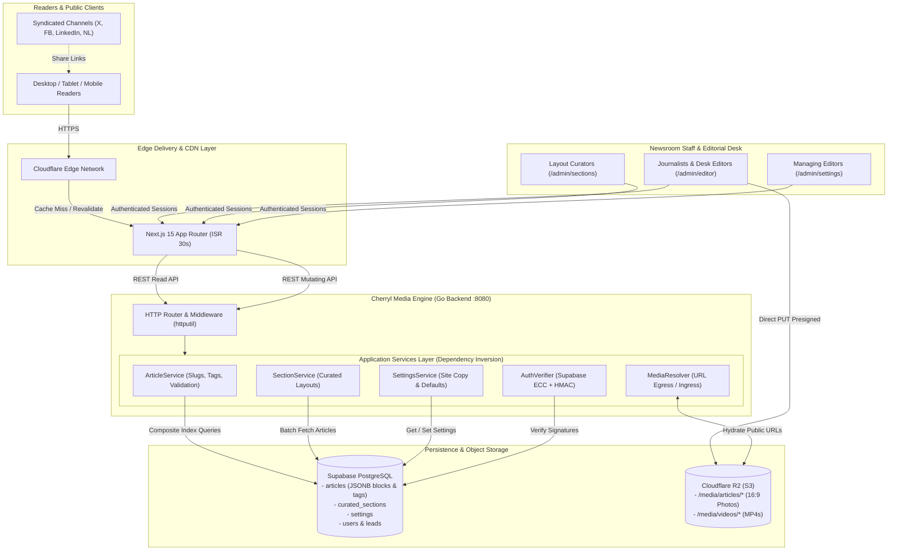

# Cherryl Media — Product Architecture & System Blueprint

> **The Definitive Product & Engineering Reference for Cherryl Media**
> Combining high-conviction African digital journalism with a sub-10ms Go media engine and edge-rendered Next.js 15 delivery.

---

## 1. Executive Product Vision & Value Proposition

**Cherryl Media** (`cherrylmedia.com`) is an independent, high-standard digital publication and news distribution network focusing on Nigerian current affairs, state government policies, enterprise commerce, cultural chronicles, and youth innovation across West Africa and the diaspora.

### The Problem in African Digital Media
1. **Sensationalist Aggregation**: Ad-bloated blogs aggregating unverified rumors with no primary source citations.
2. **Bureaucratic Stagnation**: Official state websites with inaccessible layouts, broken search, and sluggish server response times.
3. **Rigid Content Systems**: Legacy CMS platforms (e.g. monolithic WordPress) with brittle plugins, slow TTFB, and fragmented media hosting.

### The Cherryl Media Solution
- **Journalistic Verification First**: Every article supports structured inline and footer source citations, linking directly to verified official releases, regulatory gazettes (NERC, CBN, FEC), or direct interviews.
- **Dynamic Block-Based Canvas**: Stories are composed as ordered semantic blocks (`paragraph`, `heading`, `pullquote`, `image`, `video`, `link card`) with explicit order IDs.
- **Clean 10-Pillar Taxonomy**: Ten editorial pillars reflecting real reader interest with responsive navigation ergonomics that never squish across mobile, tablet, or desktop.
- **Enterprise-Grade Decoupled Engine**: Next.js 15 ISR frontend + compiled Go media engine + Supabase PostgreSQL + Cloudflare R2 object storage.

---

## 2. End-to-End System Architecture



---

## 3. Official Editorial Taxonomy (10 Pillars)

All publication output is organized under ten canonical pillars, designed to provide comprehensive national coverage while maintaining clear navigation hierarchy:

| # | Pillar Slug | Display Name | Sub-Beats & Scope |
|:---:|---|---|---|
| **01** | `state-affairs-environs` | **STATE AFFAIRS & ENVIRONS** | Sub-national governance, 36 state executive councils, regional rail/power developments, flood & environmental alerts. |
| **02** | `newsbeat` | **NEWSBEAT** | Breaking national alerts, legislative gazettes, judicial rulings, public security, federal policy dispatches. |
| **03** | `brands-smes` | **BRANDS & SMEs** | Enterprise growth, fintech innovations, consumer market pricing, local manufacturing, startups, commercial trade. |
| **04** | `opinions` | **OPINIONS** | Policy critiques, guest columns, academic commentary, economic analysis, philosophical & cultural essays. |
| **05** | `sports` | **SPORTS** | NPFL football, Super Eagles/Super Falcons, African athletics, European leagues, combat sports, grassroots talent. |
| **06** | `entertainment-lifestyle` | **ENTERTAINMENT & LIFESTYLE** | Nollywood features, Afrobeats albums & live concerts, culinary arts, fashion trends, creative industry interviews. |
| **07** | `education` | **EDUCATION** | Tertiary institutions, polytechnic reforms, WAEC/JAMB policy shifts, university research, student scholarships. |
| **08** | `thrills-tricks` | **THRILLS & TRICKS** | Practical consumer advice, life hacks, digital navigation, financial security, internet culture & curiosities. |
| **09** | `youth-corner` | **YOUTH CORNER** | Gen-Z creators, tech hackathons, campus politics, student ventures, emerging youth leadership dispatches. |
| **10** | `tour-hotels` | **TOUR & HOTELS** | Domestic travel destinations, hospitality reviews, eco-tourism resorts, cultural heritage, weekend getaway guides. |

### Responsive Navigation Rules
- **Desktop (Large Screens $\ge$ 1280px)**: Prominent top nav displays the 5 highest-traffic daily beats (`State Affairs`, `Newsbeat`, `Brands & SMEs`, `Opinions`, `Sports`), with secondary pillars in the menu drawer.
- **Laptop / Small Desktop (1024px – 1279px)**: Font sizes scale proportionally to prevent squishing or line wrapping.
- **Tablet & Mobile ($<$ 1024px)**: Top bar renders clean logo, live wire status indicator, and circular navigation icon. Full 10-pillar index expands smoothly in the slide-out menu drawer.

---

## 4. End-to-End User Journeys

### 4.1 The Reader Journey
1. **Landing & Instant Discovery**: Reader opens `cherrylmedia.com`. Page is served immediately from edge cache ($< 50\text{ms}$ TTFB).
2. **Live Wire Awareness**: Continuous ticker notice broadcasts high-priority breaking news alerts.
3. **Immersive Article Consumption**:
   - High-resolution 16:9 cover image with photographer credits.
   - Clear headline, deck, author credentials, publication timestamp, and read-time badge.
   - Text rendered with high legibility typography (65–75 characters per line).
   - Dynamic media blocks (full-bleed images, direct MP4 video, pullquotes, inline link cards).
4. **Trust & Verification**: Reader scrolls to the **Primary Sources** box to inspect verified source documents (NERC orders, gazettes, interviews) with trust badges.
5. **Deeper Exploration**: Curated related stories and "More Stories" cards guide reader deeper into the publication.

### 4.2 The Journalist / Staff Writer Journey
1. **Authentication**: Writer logs into `/admin/login` using email credentials or Supabase Auth.
2. **Story Inception**:
   - Option A: Click **"+ Write New Story"** for original reporting.
   - Option B: Select an ingested lead from the **Discovery Inbox** on the dashboard.
3. **Authoring in Article Studio (`/admin/editor`)**:
   - **Headline & Deck**: Type title; system generates URL slug.
   - **Slug Uniqueness**: Real-time debounced check verifies slug availability against PostgreSQL (displays green check or red conflict warning).
   - **Category & Tags**: Pick from the 10 pillars; typeahead tag search suggests existing legacy tags.
   - **Cover Photo Upload**: Drag-and-drop image directly triggers presigned Cloudflare R2 upload (bypassing backend CPU).
   - **Content Composition**: Add and reorder semantic blocks (paragraphs, section headers, pullquotes with attribution, inline photos, MP4 video).
   - **Internal Story Cards**: Search publication database to embed interactive cards linking related stories.
   - **Multi-Channel Copy**: Prepare pre-formatted blurbs for X (Twitter), Facebook, LinkedIn, and the newsletter.
4. **Pre-Publish Checklist**:
   - Reviewer modal confirms title, slug availability, cover image presence, and word count.
   - Click **"Confirm & Publish Story"** -> Backend sets `status: "published"`, records timestamp, and updates PostgreSQL.
   - Story becomes live globally within seconds.

### 4.3 The Layout Curator Journey (`/admin/sections`)
1. Curator opens `/admin/sections` to manage homepage layout.
2. Views real-time slot fill counts for all layout blocks (Hero Lead, Hero Secondary, Weekend Dossier, State Affairs, Newsbeat, etc.).
3. Uses ↑ and ↓ controls to reorder stories within slots.
4. Clicks **"+ Add Story Slot"** or **"Replace"**:
   - Searchable modal opens.
   - Searches across all published articles by headline, kicker, or category.
   - Selects story -> slot instantly updates.
5. Clicks **"Save Curated Layout"** -> Batch payload persists to `curated_sections` table in PostgreSQL.

### 4.4 The Managing Editor Journey (`/admin/settings`)
1. Editor opens `/admin/settings` to adjust global newsroom announcements.
2. Tabs provide dedicated controls:
   - **Homepage Hero**: Edition badge, title lead, crimson italic accent, and description.
   - **Live Wire / Ticker**: Urgent breaking notice text and ticker label.
   - **Weekend Dossier**: Dossier issue badge and heading.
   - **Distribution Network**: Syndicated readership statistics (subscribers, monthly reach).
   - **Masthead & Footer**: Bureau locations (Abuja, Lagos, London), newsroom email, copyright notices.
3. Clicks **"Save Changes"** -> Settings persist to PostgreSQL, with instant fallback to default canonical values.

---

## 5. Data Architecture & Hybrid Storage Model

### 5.1 Why a Hybrid Relational + Document Model?
- **Relational Schema**: Columns for primary identifiers (`id`, `slug`, `category`, `status`, `published_at`, `author_name`) enable fast indexing, foreign keys, and sub-10ms sorting.
- **JSONB Document Blocks**: The `body`, `related_stories`, `sources`, and `social_variants` columns store structured content as JSONB. This allows rich block types without complex relational join tables (`article_blocks`, `block_attributes`).

### 5.2 Content Block Specification (`body` JSONB)
Every content block adheres to a strict discriminated union:

```typescript
type ContentBlock =
  | { order_id: number; type: "paragraph"; text: string; isDropCap?: boolean }
  | { order_id: number; type: "heading"; level: 2 | 3 | 4; text: string }
  | { order_id: number; type: "quote"; quote: string; author: string; context?: string }
  | { order_id: number; type: "image"; src: string; storageKey?: string; caption?: string; credit?: string }
  | { order_id: number; type: "video"; src: string; storageKey?: string; poster?: string; caption?: string }
  | { order_id: number; type: "link"; title: string; url: string; publisher?: string; deck?: string; isInternal?: boolean };
```

---

## 6. Security, Authentication & Role Hierarchy

```
┌───────────────────────────────────────────────────────────────┐
│                      Authentication Gateway                   │
├──────────────────────────────┬────────────────────────────────┤
│ Local HMAC JWT Verifier      │ Supabase ECC JWKS Verifier     │
│ (HS256 with JWTSecret)       │ (ES256 with KeyID / JWKS URL)  │
└──────────────────────────────┴────────────────────────────────┘
                               │
                               ▼
┌───────────────────────────────────────────────────────────────┐
│                   Role-Based Authorization                     │
├───────────────┬───────────────────────────────────────────────┤
│ Role          │ Privileges                                    │
├───────────────┼───────────────────────────────────────────────┤
│ Admin         │ Full access: Users, Settings, Sections, Posts  │
│ Editor        │ Publish stories, curate layout slots, settings│
│ Reporter      │ Draft stories, upload media, preview articles  │
└───────────────┴───────────────────────────────────────────────┘
```

- **Token Storage**: JWT tokens are stored in the client's `localStorage` and automatically injected as `Authorization: Bearer <token>` on all API requests via `ApiClient`.
- **401 Interception**: The frontend service container detects unauthorized responses and automatically clears session state to redirect to `/admin/login`.

---

## 7. Operational Health, CI/CD & Deployments

| Component | Target Runtime | Test Command | Build Command | Latency SLA |
|---|---|---|---|---|
| **Frontend** | Node.js / Edge (Next.js 15) | `npm test` | `npm run build` | $< 50\text{ms}$ (ISR) |
| **Backend** | Compiled Go Binary | `go test ./...` | `go build ./cmd/server` | $< 10\text{ms}$ (REST) |
| **Database** | Supabase PostgreSQL | `cmd/verify-db` | `cmd/migrate` | $< 5\text{ms}$ (Indexed) |
| **Media** | Cloudflare R2 / S3 | N/A | Direct Uploads | CDN Edge Cached |
